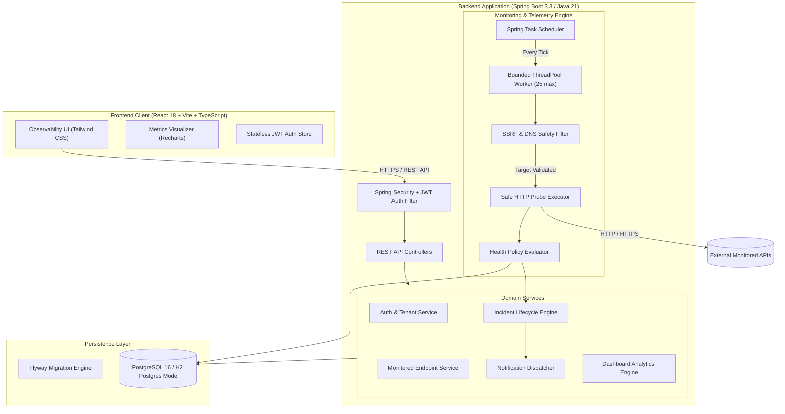

# API Sentinel — Production-Quality API Monitoring & Reliability Platform

API Sentinel is an enterprise-grade API monitoring, observability, and incident tracking platform engineered for high reliability, multi-tenant security, and real-time operational diagnostics.

---

## 1. System Architecture

API Sentinel is architected as a modular monolith in Spring Boot 3.3 (Java 21) paired with a high-performance React 18 TypeScript frontend styled with Tailwind CSS and Recharts.



---

## 2. Key Engineering Highlights & SDE Placement Focus

### 2.1 Server-Side Request Forgery (SSRF) Defense-in-Depth
- **Protocol Restraint**: Restricts schemes strictly to `http://` and `https://`. Rejects `file://`, `ftp://`, `gopher://`, `ldap://`.
- **Pre-Flight DNS Resolution & Rebinding Prevention**: Resolves domain names to `InetAddress[]` before establishing socket connections.
- **Strict Blacklisting**:
  - Loopback addresses (`127.0.0.0/8`, `::1`).
  - RFC 1918 Private Ranges (`10.0.0.0/8`, `172.16.0.0/12`, `192.168.0.0/16`).
  - Link-Local and Cloud Metadata addresses (`169.254.169.254`, `fd00:ec2::254`, `100.100.100.200`).
  - Carrier-Grade NAT (`100.64.0.0/10`) and multicast (`224.0.0.0/4`).
- **No Automatic Redirects**: HTTP redirect following is explicitly disabled (`setInstanceFollowRedirects(false)`) to prevent redirect-based SSRF bypasses.

### 2.2 Bounded Concurrency & Overlap Prevention
- Automated background checks run on a dedicated `ThreadPoolTaskExecutor` (10 core, 25 max, bounded 200-capacity queue) decoupled from HTTP request handling threads.
- In-flight check tracking using `ConcurrentHashMap.newKeySet()` prevents concurrent overlapping health checks for the same target endpoint.

### 2.3 Incident Lifecycle State Machine
- **Noise Mitigation**: Consecutive failure thresholding (default 3) prevents opening false alarms on single transient network blips.
- **Deduplication**: When an endpoint continues failing, subsequent probe failures increment the failure counter and append to the incident audit trail without spawning duplicate open incidents.
- **Automated Recovery**: When an endpoint satisfies the health policy, any open or acknowledged incident is automatically resolved, computing outage duration and firing a recovery alert.

### 2.4 Mathematical Precision in Tail Latencies
- Computes exact nearest-rank percentiles (`p50`, `p95`, `p99`) across selectable time windows (`1h`, `24h`, `7d`, `30d`), avoiding the common flaw of substituting averages for tail distributions.

---

## 3. Technology Stack

| Layer | Technologies |
|---|---|
| **Frontend** | React 18, TypeScript, Vite, Tailwind CSS, Recharts, React Router 6, Axios, Lucide Icons |
| **Backend** | Java 21, Spring Boot 3.3.5, Spring Security 6, Spring Data JPA, Bean Validation |
| **Authentication** | Stateless JWT (JJWT 0.12.6, HMAC-SHA256), BCrypt (strength 12) |
| **Database** | PostgreSQL 16 (production), Flyway Migrations, H2 in PostgreSQL mode (zero-dependency local dev/test) |
| **Testing** | JUnit 5, Mockito, Spring Boot Test, Vitest, React Testing Library |
| **Containerization** | Docker, Multi-Stage Dockerfiles, Docker Compose |
| **Documentation** | OpenAPI 3.0 / Swagger UI (`/swagger-ui.html`) |

---

## 4. REST API Specification

### Authentication
- `POST /api/auth/register` — Register a new developer account.
- `POST /api/auth/login` — Authenticate and obtain JWT Bearer token.
- `GET /api/auth/me` — Retrieve current user profile.
- `POST /api/auth/logout` — Invalidate client session.

### Monitored Endpoints
- `GET /api/endpoints` — Paginated list of monitored endpoints.
- `GET /api/endpoints/all` — Unpaginated list for selectors and dropdowns.
- `POST /api/endpoints` — Register a new endpoint (validates URL with SSRF filter).
- `GET /api/endpoints/{id}` — Get endpoint configuration and SLA parameters.
- `PUT /api/endpoints/{id}` — Update endpoint configuration.
- `DELETE /api/endpoints/{id}` — Delete endpoint and cascade historical logs.
- `POST /api/endpoints/{id}/pause` — Pause automated monitoring.
- `POST /api/endpoints/{id}/resume` — Resume automated monitoring.
- `POST /api/endpoints/{id}/check` — Trigger an immediate synchronous manual probe.
- `GET /api/endpoints/{id}/checks` — Retrieve paginated health check probe history.

### Incidents
- `GET /api/incidents` — Paginated incident list (optional filter by `status=OPEN|ACKNOWLEDGED|RESOLVED`).
- `GET /api/incidents/{id}` — Incident details with audit event timeline.
- `POST /api/incidents/{id}/acknowledge` — Acknowledge an open outage alarm.

### Dashboard Analytics
- `GET /api/dashboard/summary` — High-level summary (counts, 24h availability %, recent outages).
- `GET /api/dashboard/latency?window=24h&endpointId={id}` — p50, p95, p99, average, and time-series points.
- `GET /api/dashboard/availability?window=24h&endpointId={id}` — Availability percentage and sample counts.

### Notifications & Settings
- `GET /api/notifications` — Notification audit feed.
- `GET /api/notifications/unread-count` — Count of unread alerts.
- `POST /api/notifications/{id}/read` — Mark notification as read.
- `POST /api/notifications/read-all` — Mark all notifications as read.
- `GET /api/settings` — Get user monitoring preferences.
- `PUT /api/settings` — Update email alert destination and default thresholds.

---

## 5. Local Setup & Execution Guide

### Option A: Local Zero-Dependency Mode (Fastest for Development)

Prerequisites: JDK 21, Node.js 20+, Maven 3.9+

1. **Start the Backend**:
   ```bash
   cd backend
   mvn spring-boot:run -Dspring-boot.run.profiles=local
   ```
   *The backend starts on `http://localhost:8080` with in-memory PostgreSQL-compatible H2 and Flyway migrations.*

2. **Start the Frontend**:
   ```bash
   cd frontend
   npm install
   npm run dev
   ```
   *The frontend starts on `http://localhost:5173` with Vite proxy forwarding `/api` calls to port 8080.*

3. **Explore**:
   - Web Application: `http://localhost:5173`
   - Swagger OpenAPI Docs: `http://localhost:8080/swagger-ui.html`
   - H2 Console: `http://localhost:8080/h2-console` (JDBC URL: `jdbc:h2:mem:apisentinel`)

---

### Option B: Docker Compose (Production Setup)

```bash
# Start PostgreSQL, Backend, Frontend, and Redis
docker compose up --build
```
- Frontend available at `http://localhost:3000`
- Backend API at `http://localhost:8080`

---

## 6. Running Automated Tests

### Backend Tests (JUnit 5 + Mockito)
```bash
cd backend
mvn test
```
*Executes all 33 unit and integration tests covering SSRF validation, JWT authentication, cross-tenant isolation, incident lifecycle, policy evaluation, and nearest-rank percentiles.*

### Frontend Tests (Vitest + React Testing Library)
```bash
cd frontend
npm run test
```
*Executes Vitest test suite covering status badges, stat cards, and UI components.*
