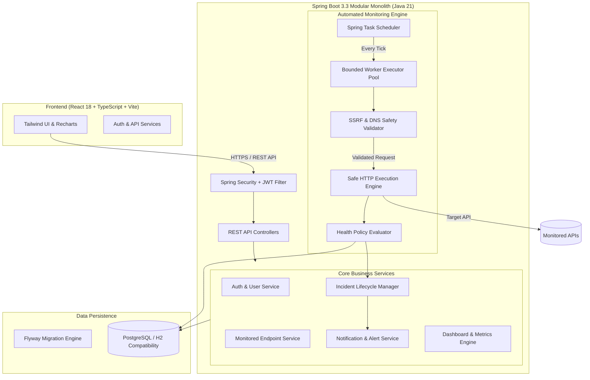
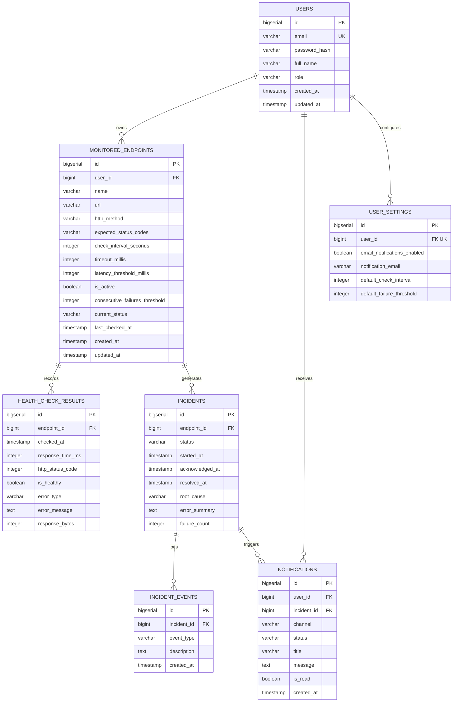
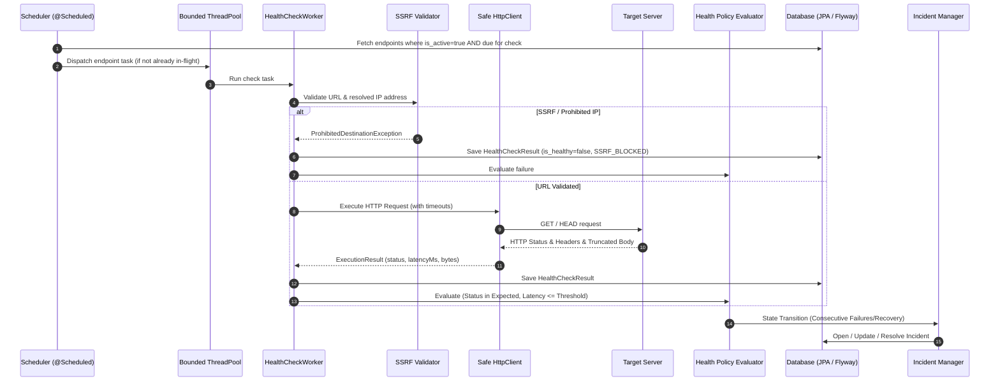

# API Sentinel — Architecture & Technical Specification

## 1. System Overview

**API Sentinel** is an enterprise-grade API monitoring and reliability engineering platform built as a modular monolith. It enables developers and DevOps engineers to register HTTP/HTTPS endpoints, continuously track latency and availability via an automated background monitoring engine, detect anomalies, manage incident lifecycles, and receive actionable alerts.

---

## 2. Security Architecture & SSRF Prevention

Because API Sentinel allows users to register arbitrary URLs for background HTTP probing, **Server-Side Request Forgery (SSRF)** is the primary threat vector. The platform implements multi-layer defense-in-depth:

### 2.1 Multi-Layer SSRF Protections
1. **Scheme Whitelisting**: Only `http` and `https` schemes are accepted. Protocols like `file://`, `gopher://`, `ftp://`, `ldap://`, or cloud-specific protocols are rejected during validation.
2. **IP & Subnet Blacklisting**:
   - IPv4 Loopback (`127.0.0.0/8`)
   - IPv6 Loopback (`::1/128`, `::/128`)
   - RFC 1918 Private Networks:
     - `10.0.0.0/8`
     - `172.16.0.0/12`
     - `192.168.0.0/16`
   - Link-Local addresses: `169.254.0.0/16` (including cloud metadata: `169.254.169.254`), `fe80::/10`
   - Unique Local IPv6: `fc00::/7`
   - Carrier-Grade NAT: `100.64.0.0/10`
   - Broadcast / Multicast / Reserved: `224.0.0.0/4`, `240.0.0.0/4`, `0.0.0.0/8`
   - Well-known cloud metadata endpoints (e.g., AWS, GCP, Azure, Oracle, Alibaba `100.100.100.200`).
3. **DNS Resolution & Rebinding Protection**:
   - Hostnames are resolved to IP addresses via `InetAddress.getAllByName(host)`.
   - Every resolved IP address is verified against the blacklist prior to initiating socket connection.
   - Redirects: Automatic HTTP redirects (`followRedirects = false`) are disabled by default. If redirect following is configured, each hop's destination URL is re-validated through the full SSRF pipeline before following.
4. **Request & Resource Boundaries**:
   - Connection timeout: Configurable, capped at maximum 10 seconds.
   - Read / Response timeout: Configurable, capped at maximum 15 seconds.
   - Response Body Limit: Truncated at 100 KB to prevent memory exhaustion / decompression bombs.
   - Header & Credential Stripping: Check logs never store Authorization headers, cookies, API tokens, or internal credentials.
5. **Multi-Tenant Data Isolation**:
   - Every protected API checks current authenticated principal ID against the endpoint's `userId`.
   - Cross-user data access is rejected with `403 Forbidden` or `404 Not Found`.

---

## 3. Database Schema (PostgreSQL + Flyway)

The schema is strictly normalized and indexed for high-volume health check time-series queries.

### Critical Indexes
- `idx_endpoints_user_id`: Fast filtering of user endpoints.
- `idx_endpoints_scheduling`: `(is_active, last_checked_at)` for rapid polling of due checks.
- `idx_checks_endpoint_time`: `(endpoint_id, checked_at DESC)` for latency graphs and uptime percentile calculations.
- `idx_incidents_endpoint_status`: `(endpoint_id, status)` for active incident evaluation and deduplication.

---

## 4. Automated Monitoring Engine Architecture

The monitoring engine is strictly isolated from inbound REST API request threads:

---

## 5. Analytics & Dashboard Metrics Calculation

1. **Uptime Percentage**:
   $$\text{Availability } (\%) = \frac{\text{Count of Healthy Checks within Window}}{\text{Total Completed Checks within Window}} \times 100$$
   Window options: 1 Hour, 24 Hours, 7 Days, 30 Days.
2. **Latency Percentiles (p50, p95, p99)**:
   - Uses SQL `PERCENTILE_CONT(0.50) WITHIN GROUP (ORDER BY response_time_ms)` in PostgreSQL, or Java in-memory sorting of windowed samples for universal dialect compatibility.
   - Distinguishes between average latency and tail percentiles.
3. **Incident MTTR (Mean Time to Resolution)**:
   - Evaluated as $\frac{\sum (\text{resolved\_at} - \text{started\_at})}{\text{Count of Resolved Incidents}}$.

---

## 6. Implementation Phases

- **Phase 1**: Environment verification, toolchain setup, architecture specification, directory scaffolding.
- **Phase 2**: Backend foundation: Spring Boot 3.3, Flyway migrations, JPA entities, JWT authentication, Security filters, User and Endpoint REST APIs, unit/integration tests.
- **Phase 3**: Monitoring engine: SSRF validator, safe HTTP client, bounded thread pool scheduler, manual check triggers, automated checks persistence.
- **Phase 4**: Incident lifecycle management, failure threshold tracking, recovery detection, notification dispatch, metrics and percentiles engine.
- **Phase 5**: Frontend: React 18, Vite, TypeScript, Tailwind CSS, Recharts, dark observability design, interactive dashboard, endpoint management, incident timeline, real API integration.
- **Phase 6**: End-to-end integration, CORS configuration, system validation tests, complete workflow verification.
- **Phase 7**: Reliability hardening, SMTP email notification handling, OpenAPI/Swagger 3 documentation.
- **Phase 8**: Production Docker & Docker Compose setup, comprehensive README, test suite execution, deployment guide.
